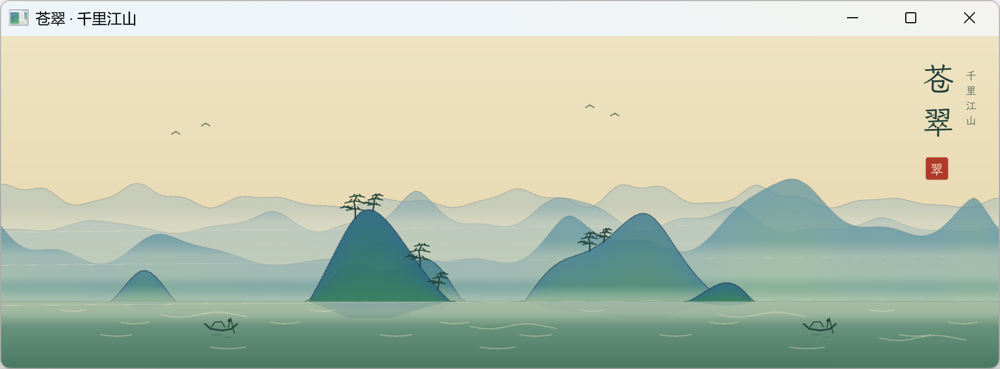
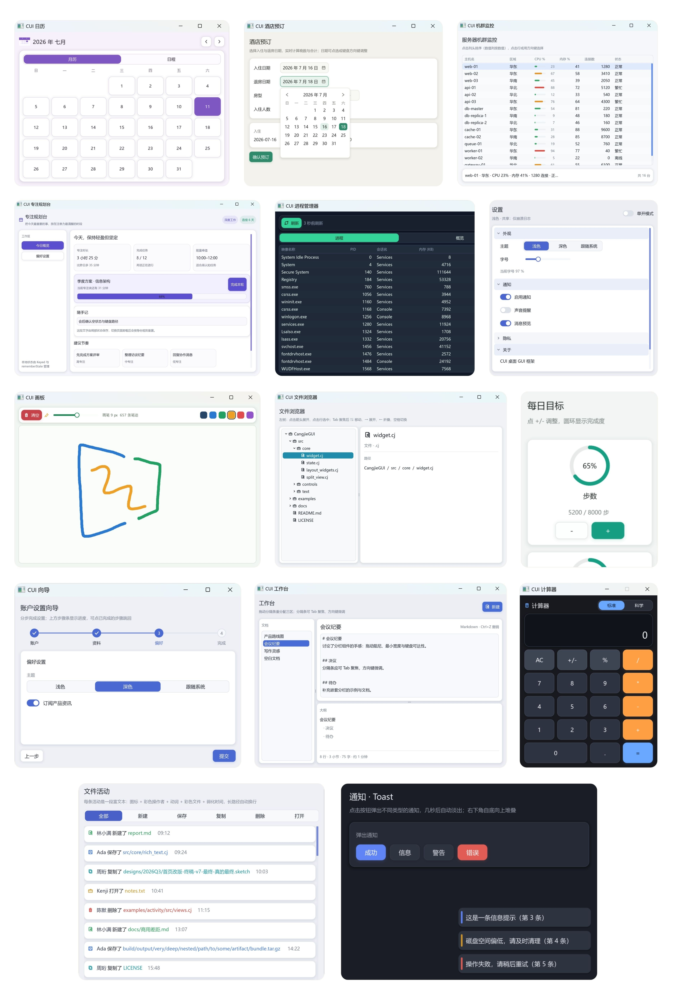

  
  
  
  
  
  

CangHui / 仓绘 
CangHui Multiplatform 
A multiplatform declarative GUI framework for Cangjie

  <strong>A GUI runtime for turning Cangjie intent into native pixels</strong> 
  Declarative semantics · deterministic probes · self-rendered surfaces · native host contracts

**English** | [中文](README.zh-CN.md)

## What is CangHui

CangHui is a self-rendered declarative GUI framework written in the
[Cangjie programming language](https://cangjie-lang.cn/). It provides the
public package chui, the SDL3 wrapper sdl, and the cuic project toolchain.

The framework keeps application intent, layout, state, input, rendering and
platform hosting as separate contracts. Common widgets stay platform-neutral;
the host owns the native window, surface, IME, accessibility, packaging and
signing facts. This makes a framework capability testable without pretending
that a host adapter or an application package is already a complete platform
release.

CangHui evolved from
[SunriseSummer/CangjieGUI](https://github.com/SunriseSummer/CangjieGUI).
The upstream attribution and MIT notice remain preserved in
[THIRD_PARTY_NOTICES.md](THIRD_PARTY_NOTICES.md). CangHui and its original
contributions are distributed under Apache License 2.0.

Older identifiers remain stable at compatibility boundaries: cui.probe.v0 and
@cui-ascii are wire identifiers, CUI_* declarations are source-compatible
names, and cuic and --cui-path are tool-compatible names. They are not
alternate package names or product brands.

## Platform status

Claims below are deliberately scoped to the proof that exists.

| Platform | Current status | What remains outside this repository |
| --- | --- | --- |
| macOS desktop | Build, framework/SDL/CLI tests, gallery and deterministic snapshots are available on this host | Publisher signing, notarization and application acceptance |
| iOS | Native-surface adapter proven for the bounded UIKit/Metal slice | Full scene rendering, IME, accessibility and product acceptance |
| HarmonyOS / HarmonyPC | Versioned XComponent host ingress, lifecycle bridge and ArkTS/IME/Ability templates | Provider pixels, HAP assembly, signing and standalone device acceptance |
| Windows / Linux | Code paths and cuic readiness probes exist | Host-verified runtime proof |
| Android | Native-surface bootstrap for arm64-v8a and x86_64 | Cangjie SDK, renderer/input bridge, APK packaging and device proof |

The [HarmonyOS provider guide](manual/reference/harmony-provider-sdk.zh-CN.md)
separates framework ingress, provider rendering, HAP hosting and device proof.
A native-surface contract is not an application package.

## Quick start

Install the framework-owned cuic tool, create a project, and let the project
lock the framework revision explicitly:

~~~bash
curl -fsSL https://raw.githubusercontent.com/Celading/CangHui/main/scripts/install-cuic.sh | bash
cuic version
cuic init HelloCangHui --name hello_canghui --platform macos
cd HelloCangHui
cuic dependency update
cuic doctor macos
cuic build macos
cuic run macos
~~~

A minimal window is ordinary Cangjie composition:

~~~cangjie
import chui.*

main() {
    let message = State<String>("Hello, CangHui")
    let app = DesktopApp(WindowSpec("CangHui Example", 640, 420))

    app.run {
        VStack {
            Panel {
                Label(message.value)
            }.flexible(false)
            Button("Update", {=> message.value = "State updated"})
                .role(ButtonRole.Primary)
                .width(160.vp)
        }.spacing(12.vp).padding(20.vp)
    }
}
~~~

Generated applications use the framework revision recorded in their manifest
and cjpm.lock. Build-like commands do not silently refresh dependencies.

## Framework surface

CangHui includes:

- Declarative composition with trailing lambdas, stable keyed identity,
  State, DerivedState, Binding and rememberState.
- Layout primitives such as VStack, HStack, ZStack, Grid, Panel, FlowRow,
  ScrollView, SplitView, Accordion and virtualized LazyColumn, LazyRow,
  LazyList and LazyGrid.
- Controls for text editing, buttons, switches, checkboxes, radios, pickers,
  steppers, sliders, progress, ratings, badges, chips, pagination, tables,
  trees, tabs, dropdowns and combo boxes.
- Focus, pointer capture, keyboard/gamepad routing, IME anchor reporting and
  bounded semantic snapshots with typed actions.
- Themes, component styles, spacing, radii, motion, typography, symbols,
  fonts and provider packages.
- SDL3 desktop rendering, retained state bookkeeping, bounded damage planning,
  FrameGraph scheduling and provider-neutral native-surface contracts.
- DesktopApplication for multiple windows and DesktopApp controls for the
  application-owned window.

The recent framework additions in this release line include:

- buildDetachedChild for composite widgets that retain their own child tree;
- ContextEventHandler for handlers that need UiContext and modifier state;
- scheduled frame requests so caret animation wakes only at phase changes;
- hidden resident-window idling and text-input focus inspection;
- chrome-free TextField.plain and runtime DesktopApp.setWindowSize;
- layout guidance for prototype-to-native migration, line-box budgeting and
  icon centering.

These APIs are framework primitives. Product behavior, visual identity and
platform packaging remain consumer responsibilities.

## Toolchain

cuic is the framework-owned project and verification entry point:

- init, dependency update, build, test and run;
- doctor for Cangjie, repository, SDL, host and platform readiness;
- probe, pview, kMode and Draw IR for deterministic debug inspection;
- design snapshot for debug-gated semantic and adaptation metadata;
- symbol and font preparation;
- prnt for settled-frame screenshots;
- check, dev and snapshot-ui lifecycle aliases.

The release/debug boundary is described in
[security and release](manual/reference/security-and-release.md). Runtime
closure, publisher credentials and app-store submission are never implied by a
successful source build.

## Architecture and proof vocabulary

The public stack is intentionally small:

~~~text
Application code
        |
        v
cuic lifecycle, probes and package contracts
        |
        v
CangHui declarative core: state, layout, controls and semantics
        |
        v
Host capabilities: window, input, IME, files, clipboard and time
        |
        v
Native adapters: SDL3 desktop, UIKit/Metal, mobile bootstrap and Harmony ingress
        |
        v
Platform runtime and GPU backend
~~~

CangHui uses four claim levels:

- Implemented: source, tests and the named host proof agree.
- Experimental: a bounded adapter works, while broader runtime proof remains open.
- Contract: CangHui defines the interface and invariants; a host still owns the implementation.
- Planned: the direction is documented but not shipped.

A screenshot proves pixels at one point in time. A probe proves declared
semantics and geometry. A package receipt proves an artifact was assembled.
A device receipt proves a specific package and revision ran on a named target.
These are separate evidence classes.

## Components and examples

- Reference components: examples/component-gallery
- Component package schema:
  contracts/canghui-component-package-v0.schema.json
- Responsive preview matrix: src/testkit/preview_matrix.cj
- Optional CangHuiKit recipes: manual/reference/canghui-kit.md
- Optional symbol providers:
  packages/symbol-material, packages/symbol-ant and packages/symbol-arco
- Optional liquid-glass style pack:
  packages/style-liquid-glass

The gallery demonstrates the framework substrate. It is not a claim that every
component package is a native platform control or that every rendering backend
is shipped and verified.

## Documentation

- [Manual home](manual/index.md)
- [Getting started](manual/guide/index.md)
- [API reference](manual/api/index.md)
- [Consumer workflow](manual/reference/consumer-workflow.md)
- [Architecture](manual/reference/architecture.md)
- [Doctor and readiness](manual/reference/doctor.md)
- [Probe and kMode](manual/reference/probe.md)
- [HarmonyOS provider guide](manual/reference/harmony-provider-sdk.zh-CN.md)
- [Desktop multi-window runtime](manual/reference/desktop-multi-window.md)
- [Scene3D semantic projection](manual/reference/scene3d.md)
- [Symbols and providers](manual/reference/symbols.md)
- [Fonts](manual/reference/fonts.md)
- [Renderer effects](manual/reference/renderer-effects.md)
- [SDL3 Apple host notes](manual/reference/sdl3-apple-host.md)
- [Release notes](manual/CHANGELOG.md)

## License

This project is released under the
[Apache License 2.0](LICENSE). See [NOTICE](NOTICE) and
[THIRD_PARTY_NOTICES.md](THIRD_PARTY_NOTICES.md) for retained upstream and
third-party attribution. SDL3 and SDL3_ttf use the Zlib license; their
notices remain with the corresponding sources.

When distributing desktop software built with CangHui, place the required SDL
and SDL_ttf dynamic libraries beside the Cangjie executable or on the target
platform's library search path. This repository does not grant publisher,
signing or store-submission rights.
